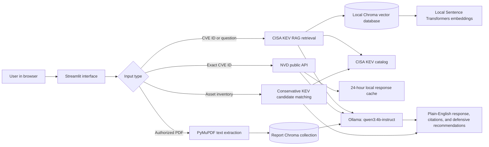

# 🛡️ CyberIntel Copilot

**A free, local-first GenAI application for defensive vulnerability research.**

CyberIntel Copilot turns a CVE ID, cybersecurity question, local asset inventory, or authorized threat-intelligence PDF into a plain-English defensive briefing. It uses Retrieval-Augmented Generation (RAG), trusted public sources, and a local Ollama model—without paid APIs, cloud LLMs, Docker, or offensive functionality.

> **Portfolio project:** built to demonstrate practical GenAI engineering: RAG ingestion, local embeddings, vector search, source-grounded generation, error handling, evaluation tests, and a shareable demo path.

## What it does

| Input | What CyberIntel Copilot produces |
| --- | --- |
| A CVE ID, such as `CVE-2021-44228` | A source-cited vulnerability briefing with official NVD facts and CISA KEV status. |
| A defensive cyber question | An evidence-backed explanation using the local CISA KEV RAG knowledge base. |
| A manually entered asset inventory | A conservative patch-prioritization table based on candidate CISA KEV matches. It never scans devices. |
| An authorized, text-based threat-intelligence PDF | A local, page-cited SOC-oriented report summary and Markdown download. |

## Architecture



The expanded component and sharing architecture are in [docs/architecture.md](docs/architecture.md).

## Tech stack

- **Python 3.12** — application and data-processing language
- **Streamlit** — local web interface
- **Ollama + `qwen3:4b-instruct`** — local LLM, configured without visible reasoning output
- **Sentence Transformers** — free local embeddings
- **ChromaDB** — local vector database
- **CISA KEV** — known-exploited-vulnerability source data
- **NVD API** — official per-CVE record lookup (no API key for low-volume use)
- **PyMuPDF** — local extraction of text-based PDFs
- **unittest** — regression and behavior checks

## Safety and scope

- Defensive research, remediation context, and security prioritization only.
- No exploit instructions, credential theft, scanning, intrusion, or offensive automation.
- CISA KEV candidate matches are **not** confirmations. Always verify product, version, and vendor guidance.
- The app distinguishes source-backed facts from general defensive guidance.
- Uploaded reports, local models, embeddings, and vector databases remain on the laptop.

## Run locally

### 1. Install the Python packages

```powershell
cd C:\Users\sanyaagr\Documents\ChatGPT\GL\cyberintel-copilot
.\.venv\Scripts\python.exe -m pip install -r requirements.txt
```

### 2. Make sure Ollama is ready

```powershell
ollama list
```

You should see `qwen3:4b-instruct`. If it is missing:

```powershell
ollama pull qwen3:4b-instruct
```

### 3. Build the local CISA KEV RAG database

```powershell
.\.venv\Scripts\python.exe scripts\build_cisa_kev_kb.py
```

This downloads the official CISA catalog, turns entries into embedding vectors locally, and stores the generated files under `data/`. They are excluded from Git because anyone can regenerate them.

### 4. Start the app

```powershell
.\scripts\start_local.ps1
```

Open the local address printed by Streamlit, usually `http://127.0.0.1:8501`.

## Test the project

```powershell
.\.venv\Scripts\python.exe -m unittest discover -s tests -v
```

The tests do not call the LLM or download sources. They cover CVE parsing, NVD/CISA status wording, asset-prioritization rules, citations, and report chunking.

## Share a temporary demo—no Docker or paid hosting

The application is deliberately local-first. A hosted free tier such as Render cannot safely run the local model and persistent RAG database with its small memory and ephemeral filesystem.

For a **temporary live demo**, keep the local app running and open a second PowerShell window:

```powershell
.\scripts\share_local_demo.ps1
```

This uses Cloudflare Quick Tunnel to create a temporary public link to the app running on your laptop. Treat it like a short presentation link: close it afterwards and never upload sensitive reports. Full instructions are in [DEPLOYMENT.md](DEPLOYMENT.md).

## Project structure

```text
cyberintel-copilot/
├── app.py                         # Streamlit user interface
├── src/cyberintel/                # Reusable application modules
│   ├── rag.py                     # Local CISA KEV retrieval
│   ├── nvd.py                     # NVD lookup and cache
│   ├── kev.py                     # CISA KEV status logic
│   ├── assets.py                  # Conservative asset prioritization
│   ├── reports.py                 # Local PDF report processing
│   └── evidence.py                # Citation and evidence helpers
├── scripts/                       # RAG build, local run, temporary sharing
├── tests/                         # Automated tests
├── docs/architecture.md           # Detailed system diagrams
├── DEPLOYMENT.md                  # Local-demo and future-hosting guidance
└── requirements.txt               # Python dependencies
```

## Version history

- **V1 — CVE Research RAG:** CISA KEV retrieval, NVD lookup, citations, and defensive briefings.
- **V2 — Asset Risk Prioritizer:** manual inventory input and transparent KEV-based prioritization.
- **V3 — Threat Report Analyzer:** local PDF ingestion, report-specific RAG, page citations, Markdown export.
- **V4 — Portfolio and demo readiness:** temporary Cloudflare sharing without Docker, deployment documentation, architecture documentation, and GitHub-ready project documentation.

## Known limitations and next improvements

- The model and database run only while the laptop is on.
- Text-based PDFs are supported; scanned PDFs need an OCR step in a future version.
- NVD is queried per CVE and cached for 24 hours; it is not a full offline NVD mirror.
- The project does not yet provide authenticated multi-user access or a permanent cloud deployment.

Potential Version 5 ideas: CVSS-aware remediation queues, SBOM import, MITRE ATT&CK enrichment with verified source data, feedback-driven RAG evaluation, and a production deployment using managed compute plus secure storage.

## GitHub publishing checklist

1. Never add `.venv/`, `data/raw/`, `data/processed/`, `.env`, screenshots containing sensitive data, or real threat reports.
2. Create a public repository if you want recruiters to view the project; use a private repository for course or employer work.
3. Add two safe screenshots: the CVE briefing tab and the asset-prioritizer tab, using public/demo data only.
4. Include this README, [architecture documentation](docs/architecture.md), and [deployment guide](DEPLOYMENT.md).
5. Run the test command before every push.

The exact browser and PowerShell steps are in [docs/github-publish.md](docs/github-publish.md).

## Data sources

- [CISA Known Exploited Vulnerabilities Catalog](https://www.cisa.gov/known-exploited-vulnerabilities-catalog)
- [NIST National Vulnerability Database](https://nvd.nist.gov/)
- [MITRE ATT&CK](https://attack.mitre.org/) — planned as a verified enrichment source for a future version
