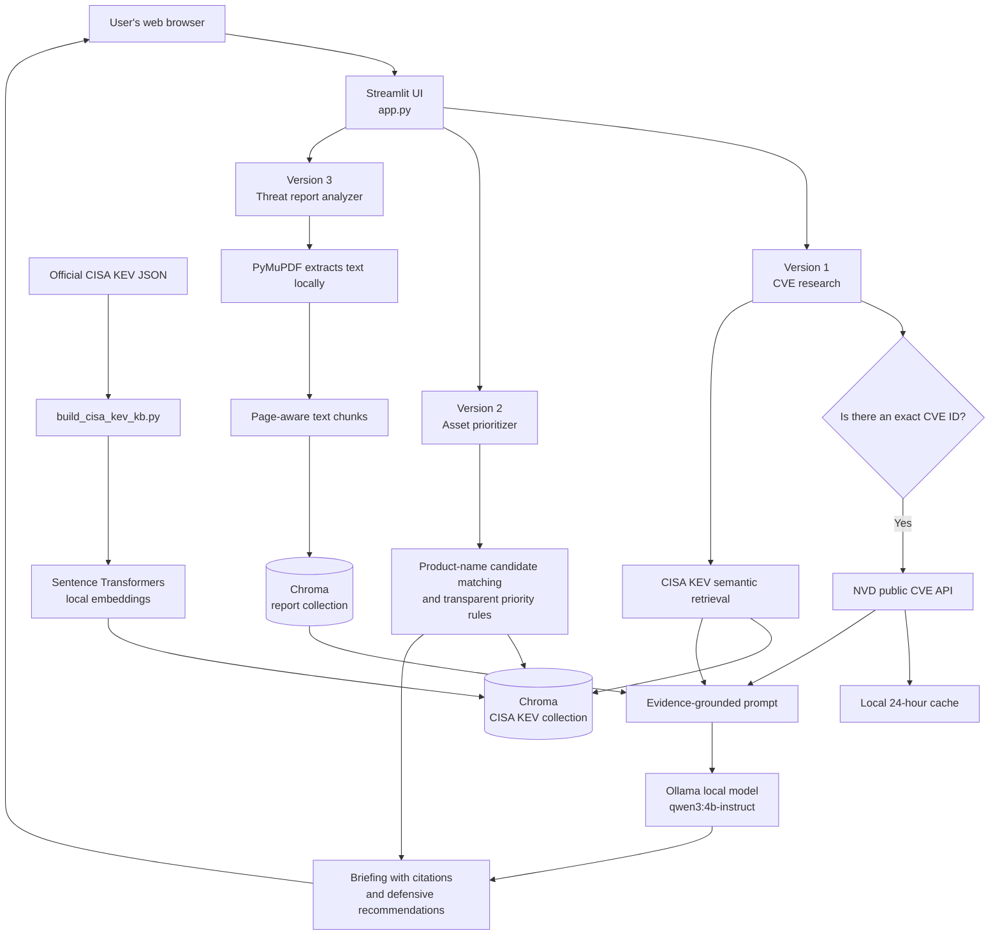
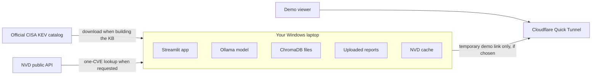
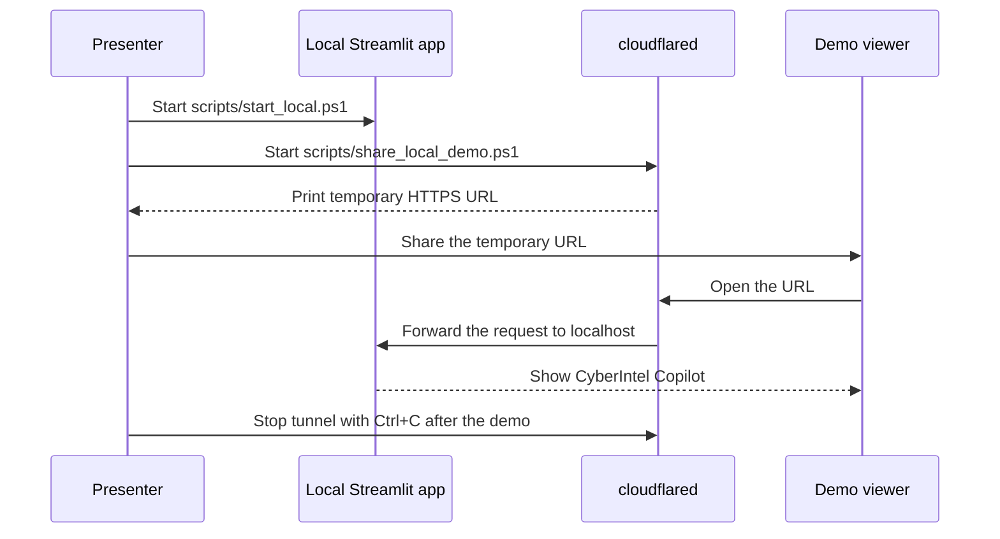

# CyberIntel Copilot architecture

This document explains the system in beginner-friendly terms. CyberIntel Copilot is a **local-first RAG application**: it finds relevant trusted material first, then gives that evidence to a local language model to write a useful answer.

## Application flow

## What RAG means here

RAG stands for **Retrieval-Augmented Generation**.

1. The CISA KEV catalog is downloaded and split into searchable records.
2. A free embedding model converts the records into numerical representations that preserve meaning.
3. ChromaDB stores those representations locally on the laptop.
4. When a user asks a question, the app retrieves the most relevant records.
5. The local Ollama model receives only the selected evidence and writes a readable, cited answer.

This is better than asking an LLM from memory alone because the answer has recent, inspectable sources attached to it.

## Data boundaries

The language model, embeddings, Chroma data, and uploaded reports stay on the laptop. The only normal external requests are downloading the public CISA catalog and looking up a requested CVE from NVD. A Quick Tunnel forwards web traffic to the running local app; it does not transform the project into a permanent cloud deployment.

## Temporary sharing flow (Version 4)

## Why Render is not the current deployment target

The full project needs a local LLM and a persistent Chroma database. Typical free web-hosting tiers have too little memory for the model, sleep when unused, and remove local files during redeploys. That would make the app slow, unreliable, or unable to retain its RAG index.

For this project, the honest zero-cost deployment choice is a temporary tunnel from the laptop. A permanent cloud version is a future production architecture and would need hosted inference or a GPU-capable server, persistent storage, authentication, and an upload-security design.

## Trust and safety controls

- Retrieves from named public sources and displays citations.
- Uses defensive-only prompting and output framing.
- Makes candidate-match uncertainty visible in asset prioritization.
- Does not scan networks or devices.
- Keeps uploaded PDFs local.
- Rejects image-only PDFs rather than pretending extraction worked.
